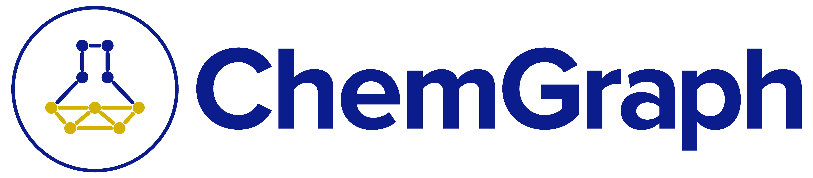

<p align="left">
  
</p>

[](https://github.com/argonne-lcf/ChemGraph/actions/workflows/tests.yml)
[](https://pypi.org/project/chemgraph/)
[](https://pypi.org/project/chemgraph/)
[](https://argonne-lcf.github.io/ChemGraph/)
[](https://github.com/argonne-lcf/ChemGraph/pkgs/container/chemgraph)
[](https://huggingface.co/spaces/Autonomous-Scientific-Agents/chemgraph-leaderboard)
[](LICENSE)

# ChemGraph

ChemGraph is an agent framework for computational chemistry and materials
science. It connects natural-language requests to molecular construction,
simulation, analysis, and reporting tools built with LangGraph, ASE, RDKit,
and the Model Context Protocol (MCP).

Use it from the command line, Python, a Streamlit web interface, or as an MCP
server. Start with local ASE calculators such as EMT and MACE, then add
TBLite, UMA, docking, XANES, retrieval, or distributed execution on systems
such as ALCF Polaris and Aurora as your workflow grows.

[Documentation](https://argonne-lcf.github.io/ChemGraph/) ·
[News and events](https://argonne-lcf.github.io/ChemGraph/news/) ·
[Papers and citations](https://argonne-lcf.github.io/ChemGraph/citation/) ·
[Model leaderboard](https://huggingface.co/spaces/Autonomous-Scientific-Agents/chemgraph-leaderboard)

> **Review results.** ChemGraph can launch calculations, run commands, and write files. Review
> generated inputs, calculator settings, convergence, units, and scientific
> conclusions before relying on a result.

## Quickstart

ChemGraph requires Python 3.11 or newer. To use the command-line application,
install it with [uv](https://docs.astral.sh/uv/guides/tools/), which creates an
isolated environment and puts `chemgraph` on your `PATH`:

```bash
uv tool install chemgraph
```

To use ChemGraph from Python or a notebook, install it into a virtual
environment instead (this also provides the CLI):

```bash
python -m venv .venv
source .venv/bin/activate              # Windows: .venv\Scripts\activate
python -m pip install chemgraph        # or: uv venv && uv pip install chemgraph
```

Choose one model provider and set only the credential it needs. The default
model is `gpt-4o-mini`.

| Provider | Setup | Example model |
| --- | --- | --- |
| OpenAI | `export OPENAI_API_KEY="..."` | `gpt-4o-mini` |
| Anthropic | `export ANTHROPIC_API_KEY="..."` | `claude-3-5-haiku-20241022` |
| Google | `export GEMINI_API_KEY="..."` | `gemini-2.5-flash` |
| Groq | `export GROQ_API_KEY="..."` | `groq:<model-id>` |
| Argo (Argonne) | `export ARGO_USER="<anl-username>"` | `argo:gpt-4o` |
| ALCF inference endpoints | `export ALCF_ACCESS_TOKEN="..."` | Use `chemgraph models` |
| Ollama | Start Ollama locally; no API key | `llama3.2` |

Check the setup, then run a lookup and a small calculation:

```bash
chemgraph run --check-keys
chemgraph run -q "What is the SMILES string for aspirin?"
chemgraph run --output last_message \
  -q "Build water from SMILES O, optimize it with EMT, and report the final energy."
```

Both queries call the selected model; the aspirin lookup also uses PubChem.
EMT needs no downloaded weights, which makes it a good first calculation.
Structures, trajectories, JSON results, and reports are written to a session
directory under `cg_logs/` (set `CHEMGRAPH_LOG_DIR` to change it).

Next steps: the [quickstart guide](https://argonne-lcf.github.io/ChemGraph/quickstart/),
[models and authentication](https://argonne-lcf.github.io/ChemGraph/models/),
and [installation options](https://argonne-lcf.github.io/ChemGraph/installation/)
for optional extras, conda, and source checkouts.

## Choose how to work

| Goal | Start here |
| --- | --- |
| Run queries, interactive sessions, and resumes | [CLI guide](https://argonne-lcf.github.io/ChemGraph/cli/) |
| Pick an agent architecture | [Workflows](https://argonne-lcf.github.io/ChemGraph/workflows/) and [skills](https://argonne-lcf.github.io/ChemGraph/skills/) |
| Embed an agent in Python | [Python API](https://argonne-lcf.github.io/ChemGraph/python_api/) |
| Use the browser interface | [Streamlit interface](https://argonne-lcf.github.io/ChemGraph/streamlit_web_interface/) (source checkout required) |
| Connect chemistry tools to another agent | [MCP servers](https://argonne-lcf.github.io/ChemGraph/mcp_servers/) |
| Choose a calculator or add spectroscopy and docking | [Calculators](https://argonne-lcf.github.io/ChemGraph/calculators/) and [examples](https://argonne-lcf.github.io/ChemGraph/example_usage/) |
| Scale to HPC or multi-agent campaigns | [HPC and Academy](https://argonne-lcf.github.io/ChemGraph/hpc_and_academy/) |
| Run in a container or cluster | [Docker](https://argonne-lcf.github.io/ChemGraph/docker_support/) and [Kubernetes](https://argonne-lcf.github.io/ChemGraph/kubernetes/) |
| Diagnose a failed run | [Troubleshooting](https://argonne-lcf.github.io/ChemGraph/troubleshooting/) |

### Workflows

| Workflow | Use it for | Requirements |
| --- | --- | --- |
| `single_agent` | Molecule lookup, ASE calculations, and reports | Default; start here |
| `main_agent` | Durable workspace sessions with skills, files, shell, and specialist delegation | Interactive, or headless with `--dangerously-skip-approvals` |
| `multi_agent` | Planner/executor decomposition and parallel subtasks | More model calls |
| `molecular_docking` | Ligand/receptor docking with AutoDock Vina | `docking` extra and Vina |
| `rag_agent` | Questions over PDF/text documents plus chemistry tools | `rag` extra |
| `single_agent_xanes` | XANES retrieval, simulation, and plotting | `xanes` extra, `MP_API_KEY` and/or `FDMNES_EXE` |

The [workflow guide](https://argonne-lcf.github.io/ChemGraph/workflows/) covers
`deep_agent`, gRASPA, and development workflows.

```bash
chemgraph run --interactive --workflow main_agent --workspace .
```

Workspace sessions can run shell commands and modify host files. Tool actions
are reviewed by default, and host shell access is not confined to the
workspace; see the [CLI guide](https://argonne-lcf.github.io/ChemGraph/cli/)
for approvals and session persistence.

### Python

`ChemGraph.run()` is asynchronous:

```python
import asyncio

from chemgraph.agent.llm_agent import ChemGraph


async def main():
    agent = ChemGraph(model_name="gpt-4o-mini", return_option="last_message")
    result = await agent.run("What is the SMILES string for aspirin?")
    print(result.content)


asyncio.run(main())
```

### MCP

Expose the general chemistry tools to any MCP client over stdio, or over
streamable HTTP at `http://localhost:9003/mcp/`:

```bash
python -m chemgraph.mcp.mcp_tools
python -m chemgraph.mcp.mcp_tools --transport streamable_http --host 127.0.0.1 --port 9003
```

With a `uv tool` install, prefix these with `uv tool run --from chemgraph`.

## News and papers

Publications, releases, talks, and media coverage are collected in the
[news archive](https://argonne-lcf.github.io/ChemGraph/news/).

If ChemGraph supports your research, cite:

> Thang D. Pham, Aditya Tanikanti, and Murat Keçeli. “ChemGraph as an
> agentic framework for computational chemistry workflows.”
> *Communications Chemistry* **9**, 33 (2026).
> <https://doi.org/10.1038/s42004-025-01776-9>

BibTeX for this article and for the HPC orchestration, ChemGraph-XANES, and
ChemGraph-IR papers is on the
[citation page](https://argonne-lcf.github.io/ChemGraph/citation/).

## Contributing and support

Contributions are welcome. See
[CONTRIBUTING.md](https://github.com/argonne-lcf/ChemGraph/blob/main/CONTRIBUTING.md)
for development setup and required checks. For help, see
[troubleshooting](https://argonne-lcf.github.io/ChemGraph/troubleshooting/) or
[open an issue](https://github.com/argonne-lcf/ChemGraph/issues).

ChemGraph is distributed under the
[Apache License 2.0](https://github.com/argonne-lcf/ChemGraph/blob/main/LICENSE).
