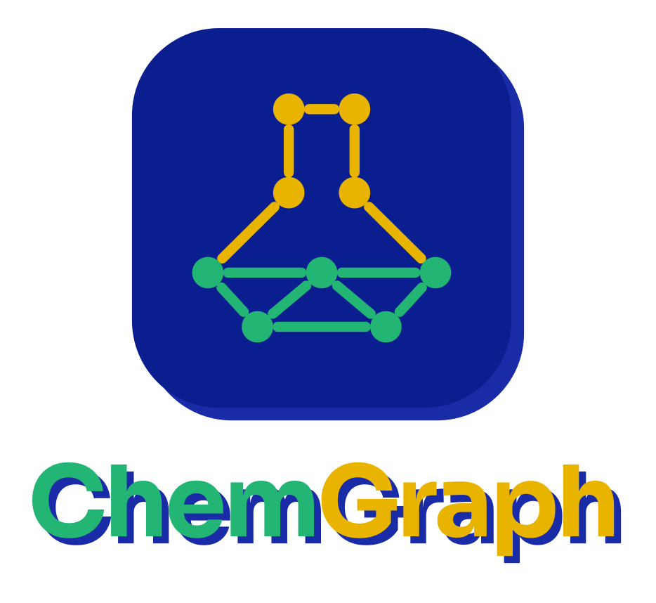

<p align="left">
  
</p>

[](https://github.com/argonne-lcf/ChemGraph/actions/workflows/tests.yml)
[](https://pypi.org/project/chemgraph/)
[](https://pypi.org/project/chemgraph/)
[](https://argonne-lcf.github.io/ChemGraph/)
[](https://github.com/argonne-lcf/ChemGraph/pkgs/container/chemgraph)
[](https://huggingface.co/spaces/Autonomous-Scientific-Agents/chemgraph-leaderboard)
[](LICENSE)

# ChemGraph

ChemGraph connects natural-language requests to computational chemistry and
materials-science workflows. Built with LangGraph, ASE, RDKit, and MCP, it can
build molecules, run simulations, analyze results, and generate reports.

Use the command line, Python API, Streamlit interface, or MCP tools. Start with
local ASE calculations, then add spectroscopy, docking, or distributed execution
as your workflow grows.

[Documentation](https://argonne-lcf.github.io/ChemGraph/) ·
[News and events](https://argonne-lcf.github.io/ChemGraph/news/) ·
[Papers and citations](https://argonne-lcf.github.io/ChemGraph/citation/) ·
[Model leaderboard](https://huggingface.co/spaces/Autonomous-Scientific-Agents/chemgraph-leaderboard)

## Quickstart

Requires Python 3.11 or newer. Install the CLI with
[uv](https://docs.astral.sh/uv/guides/tools/), which manages an isolated environment:

```bash
uv tool install chemgraph
```

Set a model credential and run a query (the default model is `gpt-4o-mini`):

```bash
export OPENAI_API_KEY="..."
chemgraph run -q "What is the SMILES string for aspirin?"
```

For a small calculation without downloading calculator weights:

```bash
chemgraph run --output last_message \
  -q "Build water from SMILES O, optimize it with EMT, and report the final energy."
```

These agent runs require a model connection; the aspirin lookup also uses
PubChem. Results are saved under `cg_logs/` by default. Check generated inputs,
units, convergence, and scientific conclusions before relying on a result.

See the [quickstart](https://argonne-lcf.github.io/ChemGraph/quickstart/) for
credential checks and artifacts, or [models and authentication](https://argonne-lcf.github.io/ChemGraph/models/)
for Argo, ALCF inference endpoints, Ollama, and other providers.
For Python, notebooks, optional extras, or source development, follow
[installation](https://argonne-lcf.github.io/ChemGraph/installation/).

## Choose how to work

| Goal | Start here |
| --- | --- |
| Run a query or resume an interactive session | [CLI guide](https://argonne-lcf.github.io/ChemGraph/cli/) |
| Work with files, skills, and specialist agents | [Workflows](https://argonne-lcf.github.io/ChemGraph/workflows/) and [skills](https://argonne-lcf.github.io/ChemGraph/skills/) |
| Embed an agent in Python | [Python API](https://argonne-lcf.github.io/ChemGraph/python_api/) |
| Use the browser interface | [Streamlit setup](https://argonne-lcf.github.io/ChemGraph/streamlit_web_interface/) (source checkout required) |
| Connect chemistry tools to another agent | [MCP servers](https://argonne-lcf.github.io/ChemGraph/mcp_servers/) |
| Choose an engine or add spectroscopy and docking | [Calculators](https://argonne-lcf.github.io/ChemGraph/calculators/) and [examples](https://argonne-lcf.github.io/ChemGraph/example_usage/) |
| Scale to HPC or multi-agent campaigns | [HPC and Academy](https://argonne-lcf.github.io/ChemGraph/hpc_and_academy/) |
| Use a container or cluster | [Docker](https://argonne-lcf.github.io/ChemGraph/docker_support/) and [Kubernetes](https://argonne-lcf.github.io/ChemGraph/kubernetes/) |

Start with the default `single_agent` workflow. For durable workspace sessions:

```bash
chemgraph run --interactive --workflow main_agent --workspace .
```

Workspace sessions can run shell commands and modify host files, with action
reviews by default. See the CLI guide for approvals, session persistence, and
workflow requirements.

## News and papers

Recent highlights include the [ALCF Inference Service feature](https://www.alcf.anl.gov/news/new-systems-boost-capabilities-alcf-inference-service),
the ChemGraphSafe hackathon prototype, and the
[ChemGraph-XANES paper](https://doi.org/10.1039/d6ra06166d).
Browse the [news archive](https://argonne-lcf.github.io/ChemGraph/news/) for
publications, presentations, releases, and media coverage.

If ChemGraph supports your research, cite:

> Thang D. Pham, Aditya Tanikanti, and Murat Keçeli. “ChemGraph as an
> agentic framework for computational chemistry workflows.”
> *Communications Chemistry* **9**, 33 (2026).
> <https://doi.org/10.1038/s42004-025-01776-9>

Related papers and BibTeX are on the [citation page](https://argonne-lcf.github.io/ChemGraph/citation/).

## Contributing and support

See [CONTRIBUTING.md](CONTRIBUTING.md) for development setup and checks.
For help, consult [troubleshooting](https://argonne-lcf.github.io/ChemGraph/troubleshooting/)
or [open an issue](https://github.com/argonne-lcf/ChemGraph/issues).
ChemGraph is distributed under the [Apache License 2.0](LICENSE).
